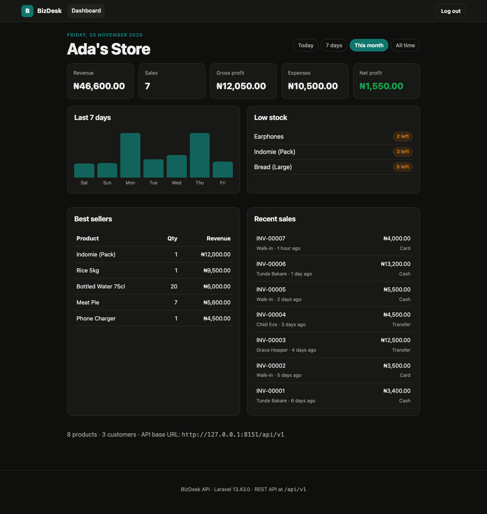
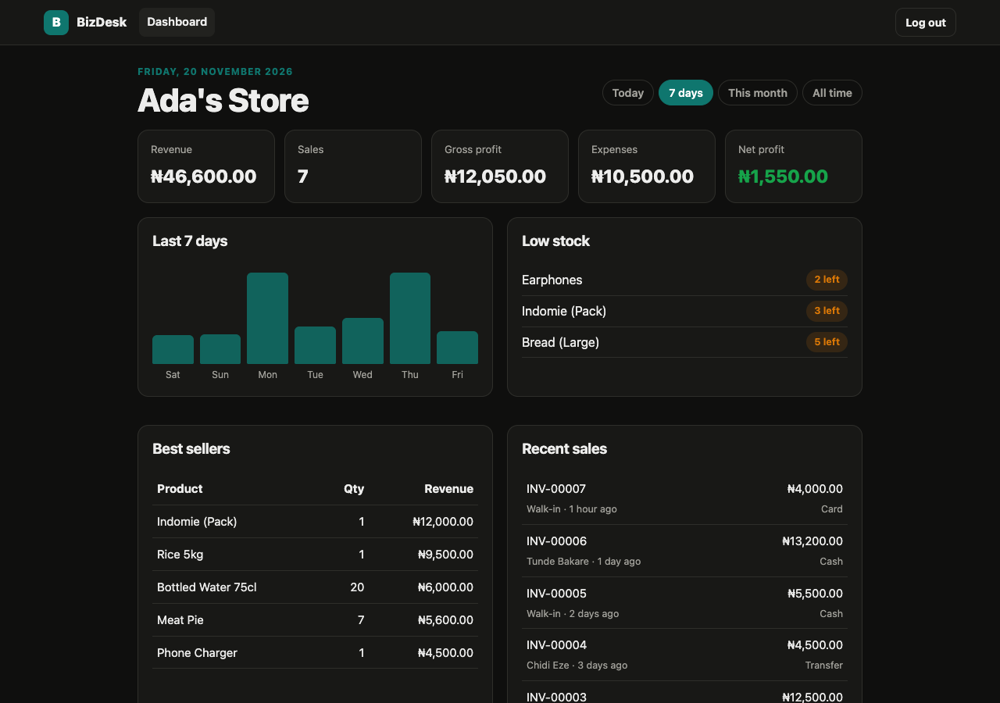
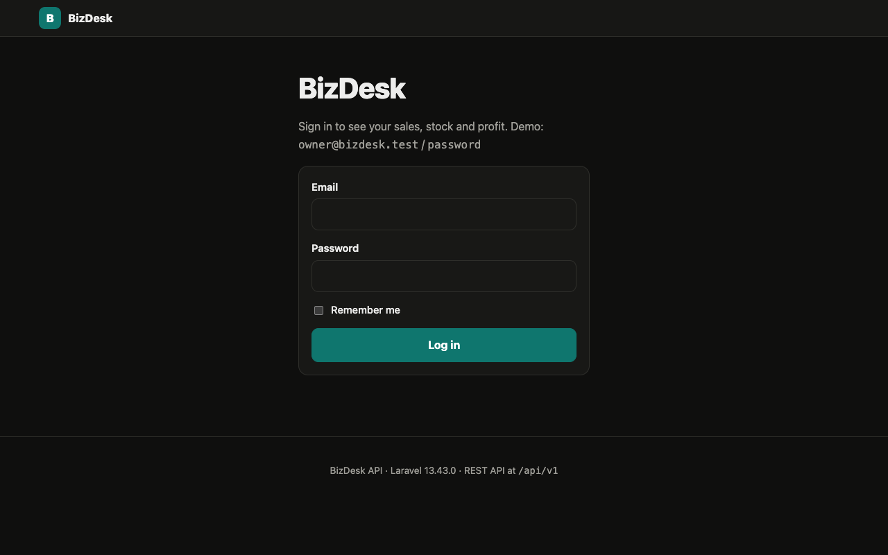
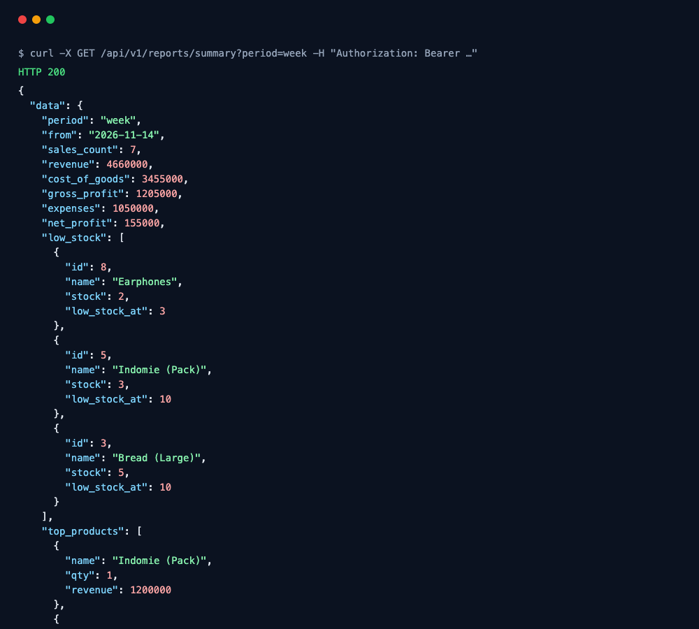
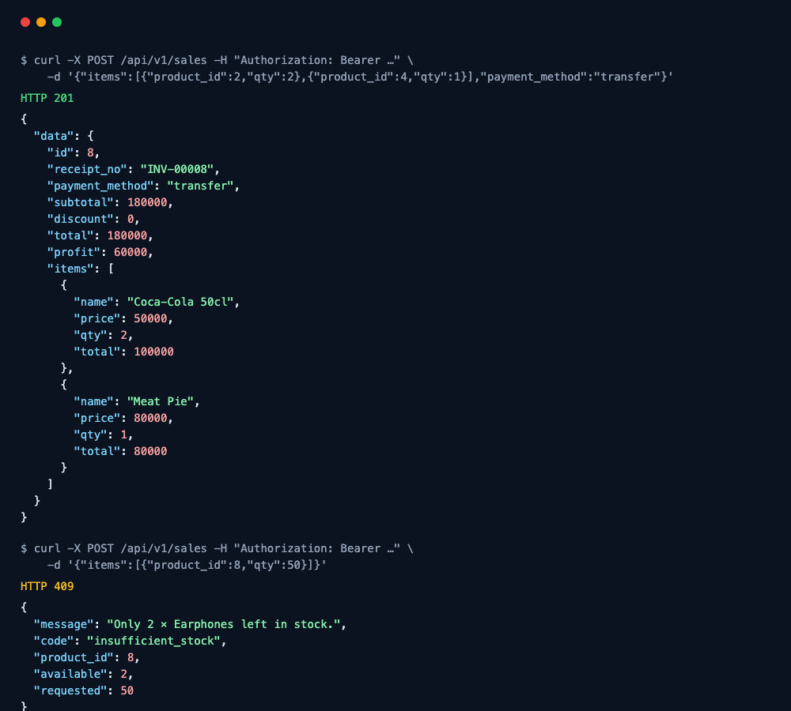

<div align="center">

# BizDesk API

**The Laravel backend for [BizDesk](https://github.com/tejHacks/bizdesk-app): a multi-business REST API plus a web dashboard for owners.**

Products and stock, customers, sales with receipts, expenses and profit reports, with token auth, strict tenant isolation
and row-locked sales so two tills can never oversell the same stock.




</div>

---

## Screenshots

| Owner dashboard (this month) | Dashboard filtered to 7 days |
|---|---|
|  |  |
| **Login** | **`GET /reports/summary`** |
|  |  |

**Recording a sale, and the API refusing to oversell (`409 insufficient_stock`):**



---

## Features

- **REST API (`/api/v1`)** for products, customers, sales, expenses and reports, consumed by the BizDesk mobile app.
- **Token auth with Laravel Sanctum.** Register or log in with a `device_name` and get a Bearer token per device.
- **Multi-business.** Every account is its own business (`business_name`, `currency`). A record that belongs to another business returns **404**, so even its existence isn't leaked.
- **Safe sales.** `POST /sales` runs in a DB transaction, locks the product rows (`lockForUpdate`), merges duplicate lines, rejects any oversell with **409**, and deducts stock all-or-nothing.
- **Immutable receipts.** Each sale line copies the product's name, price and cost, so editing a product later never changes past receipts or profit. Sales can't be edited, only **voided** (`DELETE`), which restores stock.
- **Per-business receipt numbers** (`INV-00001`, `INV-00002`, …).
- **Reports:** revenue, cost of goods, gross profit, expenses, net profit, low-stock list, top 5 products and a 7-day revenue series for `today`, `week`, `month` or `all`.
- **Web dashboard** for owners (session login, same accounts as the API) showing the same report with period filters, low stock, best sellers and recent sales.
- **Money in minor units.** Every amount is an integer in kobo/cents (`₦1,500.00` → `150000`), exactly like the mobile app.
- **Rate limited:** login/register 10 req/min, authenticated API 120 req/min.

---

## Getting started

### Prerequisites

- PHP **8.3+** with `pdo_sqlite` (or MySQL/Postgres)
- [Composer](https://getcomposer.org)

### Install and run

```bash
git clone https://github.com/tejHacks/bizdesk-app-backend.git bizdesk-api
cd bizdesk-api
composer install
cp .env.example .env
php artisan key:generate
touch database/database.sqlite
php artisan migrate:fresh --seed
php artisan serve
```

Open **http://127.0.0.1:8000** and log in with the seeded owner:

| Email | Password |
|---|---|
| `owner@bizdesk.test` | `password` |

The seeder creates **Ada's Store** with 8 products, 3 customers, a week of sales and two expenses.

> To use MySQL or Postgres, set `DB_CONNECTION`, `DB_HOST`, `DB_DATABASE`, `DB_USERNAME` and `DB_PASSWORD` in `.env` before migrating.

### Test

```bash
php artisan test
```

16 feature tests cover registration and login, guest rejection, product CRUD and restock, per-business SKU uniqueness,
tenant isolation, sale totals and stock deduction, oversell refusal, voiding, per-business receipt numbers, the report
summary, expense validation, the web dashboard login and seeder consistency.

---

## API reference

Base URL: `http://127.0.0.1:8000/api/v1`. Send `Accept: application/json` on every request, and
`Authorization: Bearer <token>` on everything except register and login.

### Auth

| Method | Endpoint | Body | Returns |
|---|---|---|---|
| `POST` | `/auth/register` | `name`, `business_name`, `email`, `password` (min 8), `device_name`, `currency?` | `201 {user, token}` |
| `POST` | `/auth/login` | `email`, `password`, `device_name` | `200 {user, token}` |
| `GET` | `/auth/me` | | `{user}` |
| `POST` | `/auth/logout` | | `204` (revokes the current token) |

```bash
curl -X POST http://127.0.0.1:8000/api/v1/auth/login \
  -H "Accept: application/json" \
  -d email=owner@bizdesk.test -d password=password -d device_name=my-phone
```

### Products

| Method | Endpoint | Notes |
|---|---|---|
| `GET` | `/products` | `?search=` (name or SKU), `?category=`, `?low_stock=1`; 50 per page |
| `POST` | `/products` | `name`, `price` (≥1), `stock` (≥0), `sku?` (unique per business), `category?`, `cost?`, `low_stock_at?` |
| `GET` | `/products/{id}` | |
| `PATCH` | `/products/{id}` | Any subset of the fields above |
| `DELETE` | `/products/{id}` | Past sales keep their copied name and price |
| `POST` | `/products/{id}/restock` | `{ "qty": 24 }` adds to stock |

### Customers

| Method | Endpoint | Notes |
|---|---|---|
| `GET` | `/customers` | `?search=` (name or phone); includes `sales_count` and `total_spent` |
| `POST` | `/customers` | `name`, `phone?`, `email?`, `notes?` |
| `GET` / `PATCH` / `DELETE` | `/customers/{id}` | Deleting a customer keeps their sales (customer becomes walk-in) |

### Sales

| Method | Endpoint | Notes |
|---|---|---|
| `GET` | `/sales` | `?from=YYYY-MM-DD`, `?to=`, `?customer_id=`; newest first, 25 per page, with items |
| `POST` | `/sales` | See below |
| `GET` | `/sales/{id}` | Includes `receipt_no` and `profit` |
| `DELETE` | `/sales/{id}` | **Voids** the sale and puts every item back in stock (`204`) |

```json
POST /api/v1/sales
{
  "items": [{ "product_id": 2, "qty": 2 }, { "product_id": 4, "qty": 1 }],
  "customer_id": 3,
  "discount": 5000,
  "payment_method": "transfer",
  "note": "Paid via bank app"
}
```

`payment_method` is one of `cash`, `card` or `transfer`. A discount larger than the subtotal is capped at the subtotal.
If any line asks for more than is in stock, nothing is saved and you get:

```json
HTTP 409
{ "message": "Only 2 × Earphones left in stock.", "code": "insufficient_stock",
  "product_id": 8, "available": 2, "requested": 50 }
```

### Expenses

| Method | Endpoint | Notes |
|---|---|---|
| `GET` | `/expenses` | Newest first, 50 per page |
| `POST` | `/expenses` | `category` (one of `Rent`, `Stock purchase`, `Salaries`, `Utilities`, `Transport`, `Marketing`, `Other`), `amount` (≥1), `spent_on?` (defaults to today), `note?` |
| `DELETE` | `/expenses/{id}` | |

### Reports

| Method | Endpoint | Notes |
|---|---|---|
| `GET` | `/reports/summary` | `?period=today\|week\|month\|all` (default `month`) |

Returns `sales_count`, `revenue`, `cost_of_goods`, `gross_profit`, `expenses`, `net_profit`, `low_stock[]`,
`top_products[]` (top 5 by revenue), `last_7_days[]` and `generated_at`.

### Errors

| Status | Meaning |
|---|---|
| `401` | Missing or invalid token |
| `404` | Not found, **or belongs to another business** |
| `409` | `insufficient_stock` when recording a sale |
| `422` | Validation failed (`{message, errors: {field: [...]}}`) |
| `429` | Rate limit hit |

---

## Project structure

```
app/
├── Actions/RecordSale.php              # Transactional, row-locked sale recording
├── Exceptions/InsufficientStockException.php   # Renders the 409 JSON response
├── Http/Controllers/
│   ├── Api/
│   │   ├── ApiController.php           # owned(): tenant isolation → 404
│   │   ├── AuthController.php          # register / login / me / logout
│   │   ├── ProductController.php       # CRUD + restock + filters
│   │   ├── CustomerController.php      # CRUD + total spent
│   │   ├── SaleController.php          # list / record / show / void
│   │   ├── ExpenseController.php
│   │   └── ReportController.php        # Summary, shared with the web dashboard
│   └── DashboardController.php         # Web login + owner dashboard
└── Models/                             # User, Product, Customer, Sale, SaleItem, Expense
database/
├── migrations/…_create_bizdesk_tables.php   # Schema (money as unsigned big integers)
└── seeders/DatabaseSeeder.php               # Ada's Store demo business
resources/views/                        # login, dashboard, layout component (no build step)
routes/api.php                          # /api/v1 routes
routes/web.php                          # /login, /dashboard
tests/Feature/BizDeskApiTest.php
```

### Data model

```
users (business) ─┬─< products
                  ├─< customers ─┐
                  ├─< sales ─────┘ (customer_id nullable)
                  │     └─< sale_items  (name, price, cost copied at sale time; product_id nullable)
                  └─< expenses
```

---

## Related

- **[BizDesk](https://github.com/tejHacks/bizdesk-app):** the offline-first Flutter mobile app this API was built for.

## License

This project is currently unlicensed. All rights reserved by the author.
